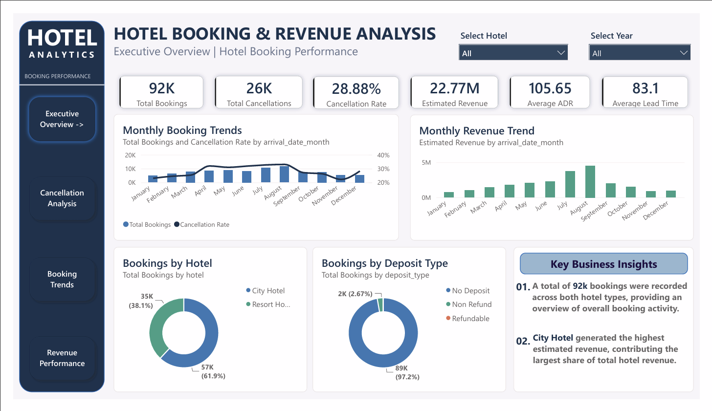
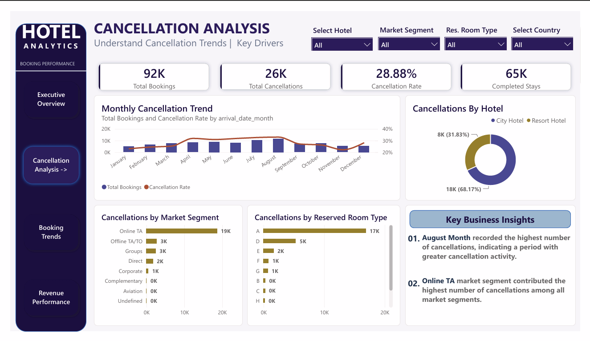
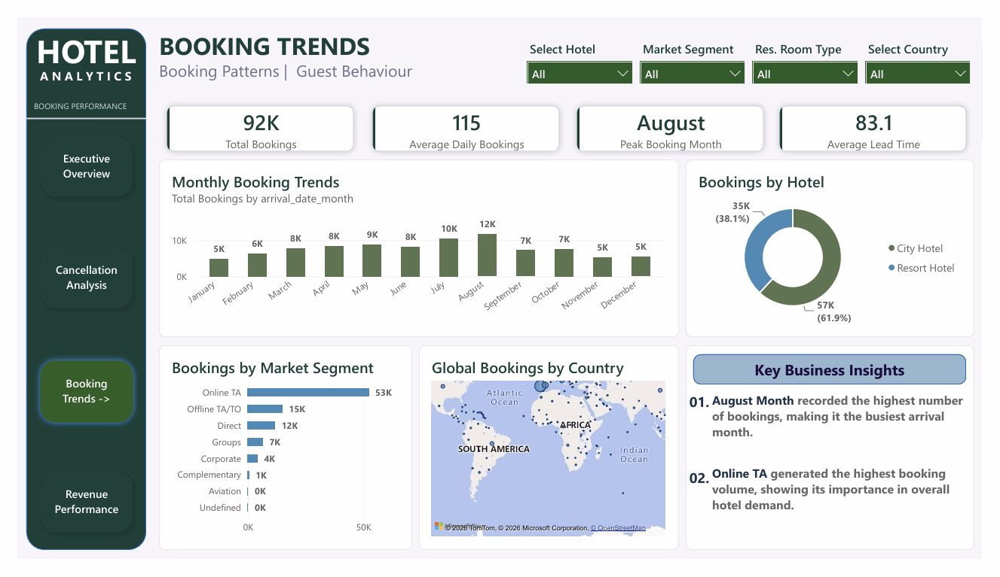
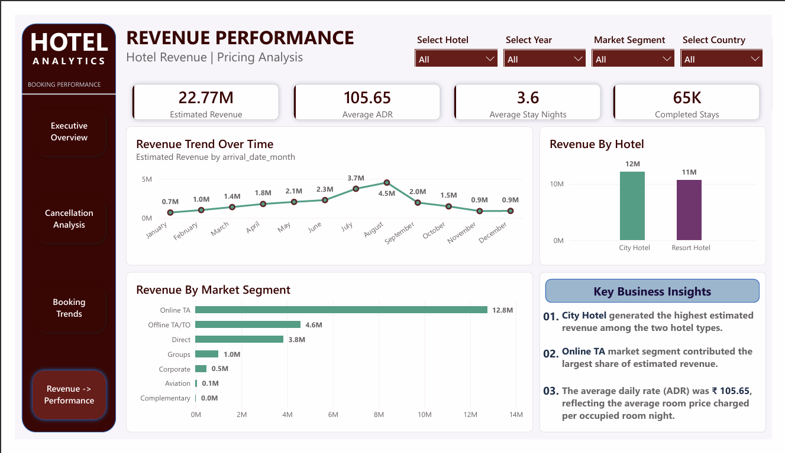

# Hotel Booking Analysis: SQL Cleaning and Power BI Dashboard

An end-to-end analysis of about 120,000 hotel booking records from two hotels in Portugal. The raw data was cleaned and analysed with SQL in PostgreSQL, then presented in a 4-page interactive Power BI dashboard.

## Business Problem

Which bookings get cancelled, and why? How do bookings, prices and revenue change through the year? Which hotel, guest countries and market segments matter most? This project answers those questions with a dashboard that a hotel management team could use.

## Dataset

- Based on the public **Hotel Booking Demand** dataset (Antonio, Almeida and Nunes, *Data in Brief*, 2019)
- Two hotels in Portugal: a City Hotel in Lisbon and a Resort Hotel in the Algarve
- Arrival dates from July 2015 to August 2017
- 121,590 rows in the messy file, 120,090 after removing exact duplicates, and 91,658 after excluding likely duplicates
- Key fields: hotel, cancellation flag, lead time, arrival date, nights stayed, guests, country, market segment, distribution channel, deposit type, price per night (ADR), reservation status and status date
- The original dataset is clean. For practice, errors were injected into it on purpose with a script (inconsistent labels, placeholders, mixed date formats, impossible values, duplicates). The cleaning, analysis and dashboard are real; the mess was injected.

## Tools Used

- **PostgreSQL 18 and pgAdmin** for data cleaning and analysis
- **SQL** (window functions, regular expressions, CASE, views)
- **Power BI Desktop** for the dashboard
- **DAX** for measures

## Data Cleaning

The full script is in `sql/01_cleaning.sql`. Every step follows the same loop: look at the problem, fix it, then check the result. The raw table is never edited, and all work happens in a copy.

- Removed 1,500 exact duplicate booking IDs
- Standardized 12 text columns (case, spaces, spelling variants and abbreviations)
- Converted placeholders such as `N/A`, `-` and `unknown` into real `NULL` values, and left missing values as `NULL` instead of filling them
- Removed extra characters from numbers (`$120`, `45 days`, `two`) and converted 20 columns from text to number types
- Converted about eight mixed date formats into one, then changed the column to the `DATE` type
- Set impossible values to `NULL` (negative prices and lead times, 0 adults, days like 32, years like 1999)
- Fixed 449 rows where the cancellation flag contradicted the reservation status
- Repaired 1,219 dates where day and month were swapped, using the arrival date and number of nights
- Flagged 28,432 likely duplicates instead of deleting them, and created a view without them

| Stage | Rows |
|---|---|
| Raw | 121,590 |
| After removing exact duplicate booking IDs | 120,090 |
| Flagged as likely duplicates | 28,432 |
| Unique rows used in the dashboard | 91,658 |

## Dashboard Pages

### 1. Executive Overview


High-level KPIs (total bookings, cancellations, cancellation rate, estimated revenue, average price and average lead time), monthly booking and revenue trends, and bookings by hotel and deposit type. Slicers for hotel and year.

### 2. Cancellation Analysis


Total cancellations and cancellation rate, with the monthly cancellation trend and cancellations by hotel, market segment and reserved room type. Slicers for hotel, market segment, room type and country.

### 3. Booking Trends


Average daily bookings, peak booking month and average lead time, with bookings by month, hotel, market segment and a map of bookings by country.

### 4. Revenue Performance


Estimated revenue, average price per night, average stay and completed stays, with the revenue trend by month and revenue by hotel and market segment.

## Key Findings

- **Duplicates change the headline number.** The cancellation rate is 37.1% with all rows and 28.9% without the likely duplicates, because most duplicates are cancelled block bookings.
- **City Hotel cancels more than Resort Hotel**, at 41.7% against 27.8%, or 31.8% against 24.1% without duplicates.
- **Non-refundable deposits are not a reason guests cancel.** 99.4% of Non Refund bookings were cancelled, but 97% of them come from the Groups and Offline TA/TO segments, which points to block bookings released together.
- **The earlier a guest books, the more likely they cancel**, from about 9% for bookings made 0 to 7 days ahead to over 50% for those made more than a year ahead.
- **The Resort Hotel is seasonal in price**, with an average nightly rate that rises from about 46 in January to about 192 in August (2016).
- **Online TA is the largest segment**, with 57% of bookings and about 70% of cancellations.
- **Portugal is the biggest guest market** (33% of bookings) and also cancels the most (39%), compared with about 19% for the UK, France and Germany.
- **City Hotel earns more in total** (about 12M against 11M in estimated revenue), but each Resort Hotel stay is worth about 18% more.

## Recommendations

1. Report cancellation rates with and without group and tour-operator block bookings, since they change the picture by about 8 percentage points.
2. Check whether the deposit type is recorded before or after a cancellation before using it to predict cancellations.
3. Send reminders or ask for reconfirmation on bookings made more than 6 months ahead, where cancellations pass 40%.
4. Review terms with online travel agents, the largest source of cancellations.
5. Plan pricing and staffing around the Resort Hotel's summer peak.
6. Record the booking date, a booking ID and the currency in the data, so duplicates and revenue can be handled more accurately.

## Data Notes and Limitations

- The data has no booking ID, so identical rows cannot be told apart from separate bookings with identical details. The 28,432 flagged rows are a lower bound, and the dashboard uses the unique rows.
- The currency of the price is not stated, so amounts should be read as currency units. Estimated revenue is price per night times nights for completed stays, and it is an estimate.
- July and August contain three years of data and the other months two, so monthly totals are not directly comparable. Use the year slicer for a like-for-like view.
- Some day/month swaps in the status date may remain, especially for cancelled bookings (estimated under 2% of rows).
- Missing values were left as `NULL`. The `company` column is 94% empty and `agent` is 14% empty, because the source uses a blank to mean none.
- The source uses both `CN` and `CHN` for China, so `CN` was merged into `CHN`.
- The messy CSV is not included, because it is a modified copy of a public dataset. The cleaning script is written for that file, so it cannot be re-run from start to finish without it.

## How to Open the Dashboard

1. Download `dashboard/Hotel_Booking_Analysis.pbix`.
2. Open it in Power BI Desktop (free to download from Microsoft).
3. In Desktop, hold **Ctrl** and click the navigation buttons to switch pages.

The file contains a copy of the data, so it opens without the database. A static PDF version is also available at `dashboard/Hotel_Booking_Dashboard.pdf`.

The full analysis results are in `FINDINGS.md`, and the queries are in `sql/02_analysis.sql`.

## Project Structure

```
hotel-bookings-analysis/
├── README.md
├── FINDINGS.md
├── sql/
│   ├── 01_cleaning.sql
│   └── 02_analysis.sql
├── dashboard/
│   ├── hotel_booking_dashboard.pbix
│   └── hotel_booking_dashboard.pdf
└── screenshots/
    ├── page1_overview.png
    ├── page2_cancellations.png
    ├── page3_booking_trends.png
    └── page4_revenue.png
```

## Author

**ASHOK KUMAR JENA** | [LinkedIn](https://www.linkedin.com/in/ashokkumarjena/)
